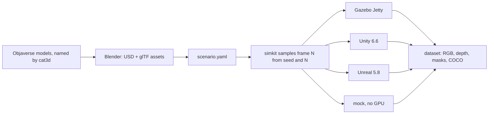

# simkit

**Synthetic training data for robotics, from any engine.** Describe a scene
once; get the same labeled dataset (RGB, depth, instance masks, COCO boxes)
from Gazebo, Unity or Unreal.


## How it works



All randomness happens in Python, so frame *N* is the same scene in every
engine. Per-stage diagrams: [docs/state](docs/state/README.md).

## Install

```bash
pip install -e .
```

Python 3.10+. Install only the engines you render with:

| Engine | Setup |
|---|---|
| mock | nothing; draws boxes to test the pipeline |
| Gazebo Jetty | `sudo apt install gz-jetty` ([OSRF apt repo](https://gazebosim.org/docs/jetty/install_ubuntu/)) |
| Unity 6.6 | build the player once: `Unity -batchmode -quit -projectPath unity -executeMethod Simkit.Editor.SimkitBuild.Linux` |
| Unreal 5.8 | `export SIMKIT_UNREAL_EDITOR=/path/to/UnrealEditor` |

## Use

```bash
simkit validate scenarios/warehouse_pallets.yaml
simkit generate scenarios/warehouse_pallets.yaml --engine mock --out data/demo --frames 20
```

The textured test scene needs its assets built once with Blender 5.2, then renders in any engine:

```bash
blender -b --python-exit-code 1 -P scenarios/objaverse_yard/build_scene.py -- OBJAVERSE_GLBS POLYHAVEN_SCENES
simkit generate scenarios/objaverse_yard/scene.yaml --engine unity --out data/yard
```

## Output

Each frame gives RGB, COCO boxes, an instance mask and metric depth, and the
engines agree to within a few edge pixels:


```
data/yard/
  rgb/000000.png         depth/000000.exr (meters)    instances/000000.png (uint16 ids)
  annotations.json (COCO)   frames.jsonl (scene + intrinsics)   manifest.json
```

<details>
<summary>More frames: the robot camera moves, the layout stays fixed</summary>


</details>

## Assets

The test scene uses [Objaverse](https://objaverse.allenai.org/) models
categorized with [cat3d](https://github.com/michael-kato/cat3d), which renders
each file and names it after what a local vision model sees. That made it
possible to pick pallets, crates, barrels and forklifts out of thousands of
unnamed files. `build_scene.py` then scales them to real size and exports USD
with glTF copies.

## Docs

- [docs/state](docs/state/README.md): how the pipeline fits together, one page per stage
- [docs/engines.md](docs/engines.md): coordinate conventions per engine, adding an engine

<details>
<summary>Design rules</summary>

1. **One canonical frame.** Everything stored or exchanged is ROS REP-103
   (x forward, y left, z up, meters). Conversion happens only inside adapters.
2. **Randomness lives in Python, not in the engine.** Frame *N* is fully
   determined by `(seed, N)`, so it's identical across engines and can be
   regenerated, sharded (`--start`) or compared sim-to-sim.
3. **Training code never knows which engine made the data.**
4. **Autonomy code never knows whether it's talking to a sim or a robot.** It
   only sees `interfaces/ros2_contract.yaml`.

</details>

<details>
<summary>Repository layout</summary>

| Path | What it defines |
|---|---|
| `source/` | The `simkit` package: scenario sampling, frame conventions, dataset writer, CLI |
| `source/adapters/` | One adapter per engine; `remote.py` is the socket protocol for Unity and Unreal |
| `unity/`, `unreal/` | Engine-side projects that serve simkit's protocol |
| `scenarios/` | Example scenarios; `objaverse_yard/` also holds its Blender build script |
| `robot/robot.urdf` | Robot description |
| `interfaces/ros2_contract.yaml` | ROS 2 topics and TF frames every sim and the real robot expose |

</details>

<details>
<summary>Roadmap</summary>

- [ ] Isaac Sim and Blender adapters (stubs today)
- [ ] ROS 2 package: `robot_state_publisher` launch + contract conformance test node
- [ ] rosbag2 (MCAP) recording of closed-loop runs
- [ ] Docker images (ROS 2 Jazzy + Gazebo; Isaac Sim container) and cloud GPU scripts
- [ ] Dataset versioning with DVC
- [ ] Baseline detector training + sim-vs-real evaluation report
- [ ] Sensor noise models (noise, blur, exposure, lens distortion) applied post-render, engine-independent

</details>

## License

MIT
