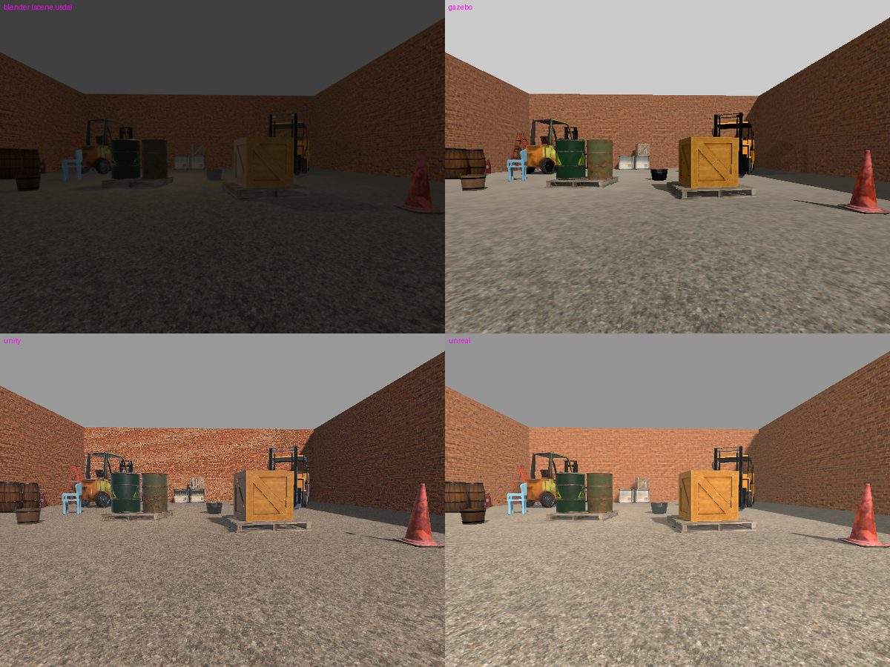
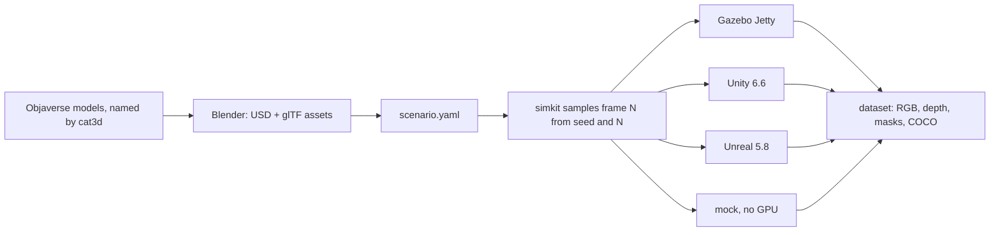
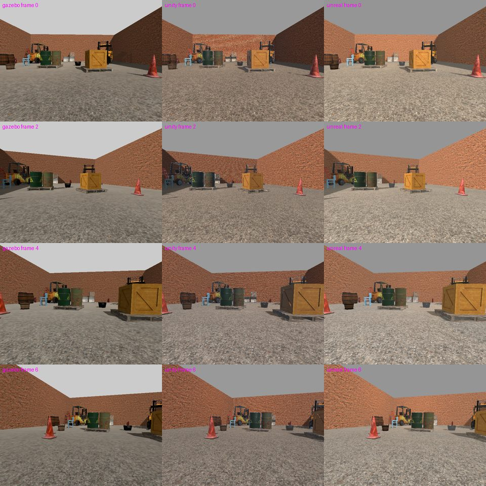

# simkit

**Synthetic training data for robotics, from any engine.** Describe a scene
once; get the same labeled dataset (RGB, depth, instance masks, COCO boxes)
from Gazebo, Unity or Unreal.



## How it works



## Install

```bash
pip install -e .
```

Python 3.10+. Install only the engines you render with:

| Engine | Setup |
|---|---|
| mock | nothing; draws boxes to test the pipeline |
| Gazebo Jetty | `sudo apt install gz-jetty` ([OSRF apt repo](https://gazebosim.org/docs/jetty/install_ubuntu/)) |
| Unity 6.6 | build the player once: `Unity -batchmode -quit -projectPath unity -executeMethod Simkit.Editor.SimkitBuild.Linux` |
| Unreal 5.8 | `export SIMKIT_UNREAL_EDITOR=/path/to/UnrealEditor` |

## Use

```bash
simkit validate scenarios/warehouse_pallets.yaml
simkit generate scenarios/warehouse_pallets.yaml --engine mock --out data/demo --frames 20
```

The textured test scene needs its assets built once with Blender 5.2:

```bash
blender -b --python-exit-code 1 -P scenarios/objaverse_yard/build_scene.py -- OBJAVERSE_GLBS POLYHAVEN_SCENES
simkit generate scenarios/objaverse_yard/scene.yaml --engine unity --out data/yard
```

Its models come from [Objaverse](https://objaverse.allenai.org/), categorized
with [cat3d](https://github.com/michael-kato/cat3d), which names each file
after what a local vision model sees.

## Example

**Input**, a scenario (excerpt of `scenarios/objaverse_yard/scene.yaml`). A
`[min, max]` range is sampled per frame; a single value is fixed:

```yaml
seed: 3
frames: 8
assets:
  - {name: yard, source: scenarios/objaverse_yard/assets/yard/yard.usd, background: true, placement: {x: 0, y: 0, z: 0}}
  - {name: wooden_pallet, label: pallet, source: scenarios/objaverse_yard/assets/wooden_pallet/wooden_pallet.usd, placement: {x: 4.2, y: -1.4, z: 0, yaw_deg: 8}}
camera:
  width: 640
  height: 480
  horizontal_fov_deg: 87
  placement: {x: [0.0, 1.5], y: [-1.0, 1.0], z: [0.55, 0.65], yaw_deg: [-20, 20]}
lights:
  - {type: sun, intensity: [800, 1500], azimuth_deg: [120, 240], elevation_deg: [35, 65]}
```

**Output**, the same layout from every engine, which agree to within a few edge pixels:

```
data/yard/
  rgb/000000.png         depth/000000.exr (meters)    instances/000000.png (uint16 ids)
  annotations.json (COCO)   frames.jsonl (scene + intrinsics)   manifest.json
```


<details>
<summary>More frames: the robot camera moves, the layout stays fixed</summary>



</details>

## Guidelines

- **One frame for everything:** ROS REP-103 (x forward, y left, z up, meters). Only engine adapters convert.
- **Randomness lives in Python:** frame *N* is fixed by `(seed, N)`, so it can be regenerated, sharded (`--start`) or compared across engines.
- **Engine-blind downstream:** training reads only the dataset layout; autonomy code sees only `interfaces/ros2_contract.yaml`.
- **Assets:** `source` names a `.usd`; Gazebo and Unity load the sibling `.glb`. Mark floors and walls `background: true` to keep them out of masks.

## Gotchas

- Run simkit from the repo root: asset paths resolve from the working directory.
- Rebuild the Unity player after changing anything in `unity/`; a stale player runs old code silently.
- Colors and brightness differ slightly between engines; geometry, masks and depth match.
- Area lights work only in Unreal. Gazebo masks hold at most 255 objects per frame.
- A failed run still writes `annotations.json` for the frames it finished; check the exit code.
