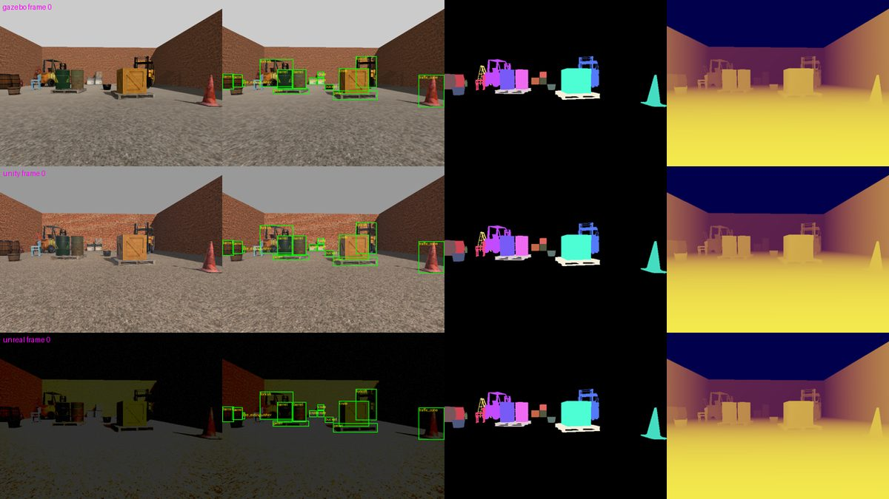
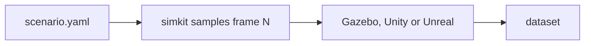

# simkit

Renders one scenario file into the same labeled dataset (RGB, depth, instance
masks, COCO boxes) in Gazebo, Unity or Unreal.





## Install

```bash
pip install -e .
```

Then the engine you render with: Gazebo Jetty (`gz-jetty`), Unity 6.6 (build
the player: `Unity -batchmode -quit -projectPath unity -executeMethod Simkit.Editor.SimkitBuild.Linux`),
or Unreal 5.8 (`export SIMKIT_UNREAL_EDITOR=/path/to/UnrealEditor`).

## Use

```bash
simkit generate scenarios/warehouse_pallets.yaml --engine mock --out data/demo
```

`--engine` is `mock` (no GPU), `gazebo`, `unity` or `unreal`. The textured test
scene, `scenarios/objaverse_yard`, uses Objaverse models named with
[cat3d](https://github.com/michael-kato/cat3d); build its assets once with
`blender -b -P scenarios/objaverse_yard/build_scene.py -- OBJAVERSE_GLBS POLYHAVEN_SCENES`.

## Gotchas

- Run from the repo root; asset paths are relative to it.
- Rebuild the Unity player after changing `unity/`.
