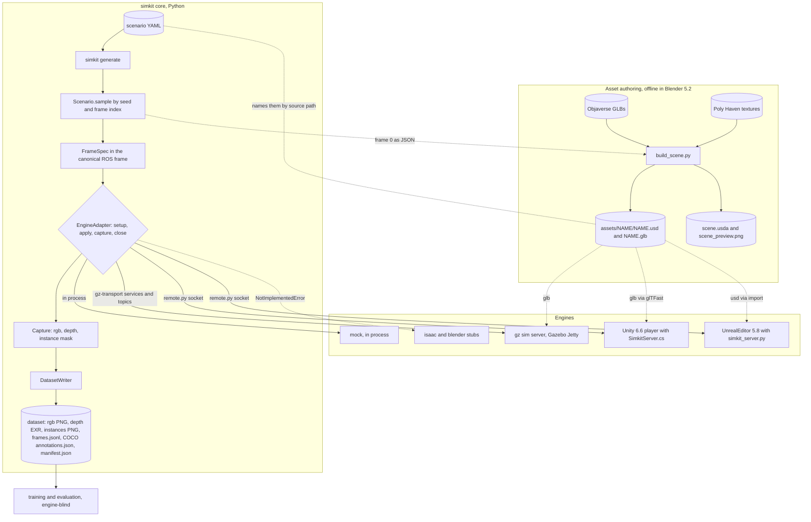

# simkit pipeline

simkit turns a scenario file into a labeled image dataset. Python samples
every random choice per frame, so frame *N* is the same scene in every engine.
An engine adapter renders that frame and hands back RGB, depth and an instance
mask. The dataset writer stores them in one layout whatever engine made them.
Blender prepares the 3D assets offline: one USD file per model, with a glTF
copy for engines that cannot load USD.

What can be rendered depends on the engine being installed and, for Unity, on
a player built from `unity/`. Isaac Sim and Blender rendering are stubs. After
a run you get a dataset folder plus an engine log in `logs/<run>/`.

Arrows are relationships, not a sequence: calls, data handed over, files read.
Dotted arrows are file references. For the order of one run see
[frame generation](frame-generation.md). For each engine's transport and
capture see [engine adapters](engine-adapters.md). For how assets are made
see [asset build](asset-build.md).

## Canonical frame

Everything stored or exchanged is in the ROS REP-103 frame: x forward, y left,
z up, meters, quaternions as (x, y, z, w). Only adapters convert, with
[frames.py](../../source/frames.py). The conventions table and the rules for
adding an engine are in [docs/engines.md](../engines.md).

Asset files follow one more rule: a `.glb` is the plain Y-up rotation of its
Z-up `.usd`, glTF (x, y, z) = canonical (x, z, -y). That is how Blender
exports it, and both Gazebo and Unity correct for it (`frames.GLTF`).

## Scenario and FrameSpec

A scenario lists assets with fixed values or ranges, a camera and lights
([scenario.py](../../source/scenario.py)). `Scenario.sample(index)` seeds a
generator with `(seed, index)`, so any frame can be regenerated alone or in
another engine. Instance ids start at 1 and count only non-background assets.
Assets marked `background: true` get instance id 0, the id masks use for
background.

## Asset resolution

An object's `source` names the canonical USD file. Each adapter asks
`resolve_asset` for the first sibling export with an extension it can load:
`.glb` for Gazebo and Unity, `.usd` first for Unreal. `primitive:cube` is a
1 m cube. Relative paths are resolved from the working directory, not from
the scenario file.

## Dataset

The layout is documented at the top of [dataset.py](../../source/dataset.py):
`rgb/`, `depth/` (EXR, meters, inf for no hit), `instances/` (uint16 ids),
`frames.jsonl` (each FrameSpec plus the intrinsics K), COCO `annotations.json`
built from the masks for labeled objects only, and `manifest.json`.

## Gaps

- Lighting is not engine-neutral. The scenario has no ambient light, so
  Gazebo and Unity each add a flat 0.3 ambient and Unreal adds none. Engines
  without physical light units scale intensity by `REFERENCE_LUX`
  ([base.py](../../source/adapters/base.py)), and Unreal sets exposure for it.
  Colors and brightness differ between engines while geometry, masks and
  depth agree.
- Agreement was measured on two scenarios only, primitive cubes and the
  objaverse yard: masks differ by 0 to 10 edge pixels per frame and the
  median depth difference is 0. Other scenes, lights and camera models are
  not verified.
- `tests/` predates this map and was not run against the current code.
- Isaac and Blender adapters only raise `NotImplementedError`.
