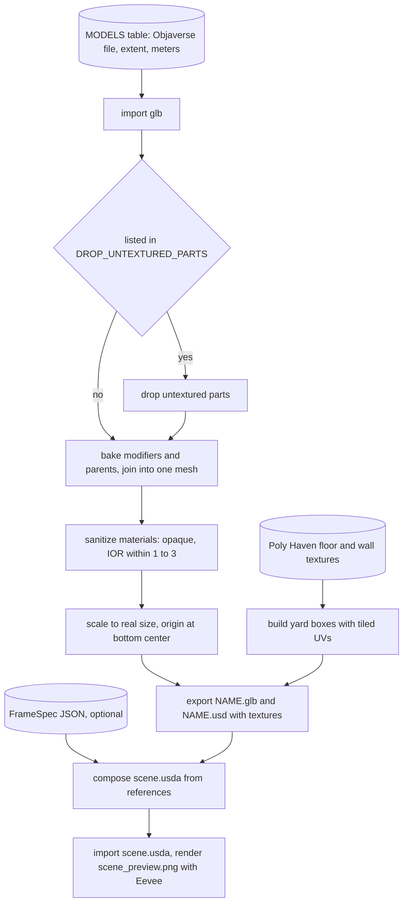

# Asset build in Blender

Assets are made offline, before any render. Run
[build_scene.py](../../scenarios/objaverse_yard/build_scene.py) in Blender
5.2 from the repo root (the command is in its docstring). For every model in
its `MODELS` table it writes `assets/<name>/<name>.usd`, the canonical asset,
and a sibling `<name>.glb` for engines that load glTF. Given a FrameSpec as
JSON, it also composes `scene.usda` and renders a preview from it. The
outputs are generated and stay out of git, so a fresh checkout needs the
local Objaverse and Poly Haven folders and one run of this script.

## Join

Engines import one mesh per asset. Unreal keeps only the first static mesh a
file produces, so a model must be a single object. Modifiers and parent
transforms are baked into the mesh. Normals are flipped where a transform
mirrors.

## Sanitize materials

Some Objaverse glTFs carry alpha that USD readers show as glass, or an IOR of
1000 that they show as mirrors. Props are made opaque and any IOR outside
1 to 3 becomes 1.5. Models with genuine cutouts, such as foliage, would lose
them.

## Drop untextured parts

Opt-in per model. The wooden pallet ships a white copy of itself in the same
place and a stray icosphere. They win the depth test from low viewpoints.

## Fit

Each model is scaled so one extent, height or longest horizontal length,
matches a real-world size. Its origin moves to its bottom center. That is why
`scene.yaml` stacks objects by adding heights: the pallet top is at 0.144 m.

## Compose scene.usda

The stage is Z-up, in meters. It references each asset's USD at its frame-0
pose, with `simkit:instance_id` and `simkit:label` attributes. It also holds a
USD camera and UsdLux lights. Importing it back into Blender and rendering
the preview checks that the references and transforms resolve.

## Gaps

- `MODELS`, target sizes and `DROP_UNTEXTURED_PARTS` were chosen by looking
  at thumbnails. Model names in the Objaverse folder are not reliable labels.
- `BODY_TO_USD_CAMERA` repeats `R_BODY_OPTICAL @ R_OPTICAL_OPENGL` from
  `frames.py`, because Blender's Python cannot import simkit. Changing one
  without the other breaks the preview camera.
- Light intensities in `scene.usda` use Blender's 683 lm/W conversion. The
  preview's brightness is not comparable to the engines'.
- Vertex colours survive into USD as `displayColor`. Unreal ignores it (see
  [engine adapters](engine-adapters.md)).
- Blender prints an add-on traceback at exit. It is not from this script.
