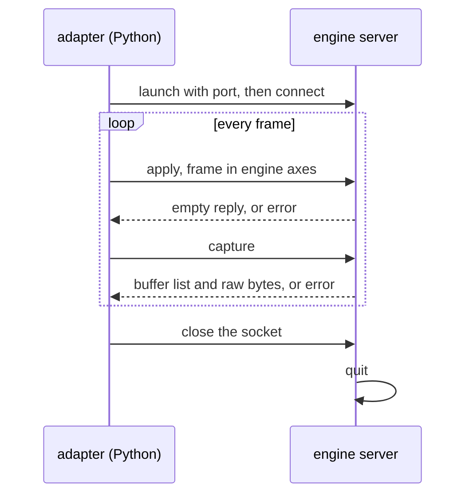

# Engine adapters

Every adapter implements the same contract
([base.py](../../source/adapters/base.py)): `setup` once, then `apply(frame)`
and `capture()` per frame, then `close`. The adapter converts poses into the
engine's axes and units, resolves each asset to a file the engine can load,
and converts the result back into a `Capture` in simkit conventions. It never
samples randomness. `--engine NAME` picks one through `ADAPTERS` in
[adapters/\_\_init\_\_.py](../../source/adapters/__init__.py), importing it
only when used.

| Engine | Started as | Talks over | Meshes | Instance ids come from | Id limit |
|---|---|---|---|---|---|
| mock | nothing, in process | function calls | ignored, draws squares | the squares it draws | none |
| Gazebo Jetty | `gz sim -s --headless-rendering` on a generated world | gz-transport | `.glb` with a Y-up correction | semantic segmentation sensor, label = id | 255, checked |
| Unity 6.6 | the player built from `unity/` | remote.py socket | `.glb` via glTFast | Renderer Shader User Value, written by a Render Graph pass | 32-bit |
| Unreal 5.8 | `UnrealEditor` headless on `unreal/` | remote.py socket | `.usd` imported | base-color pass with one flat id material per object | 65535, not checked |
| Isaac, Blender | stubs | | | | |

## Remote engines

Unity and Unreal run simkit's server inside their own process. The Python
side is [remote.py](../../source/adapters/remote.py): it launches the engine
with a free port, connects, and sends one request at a time. Each message is
two little-endian uint32 lengths, a JSON header and a payload.

`engine_frame` turns a FrameSpec into the apply message: poses through
`pose_to_engine`, lengths in engine units, assets resolved, and each light's
rotation chosen so that its +x is the direction the light travels. A capture
reply lists its buffers (`name`, `dtype`, `shape`) and sets `flip_y` when
rows run bottom to top. `decode_buffers` turns them into arrays.

## Gazebo

The adapter writes a world with one camera model holding an RGB-D sensor and
a semantic segmentation sensor, both at 20 Hz, and keeps the world paused.
Apply removes last frame's models and lights, spawns this frame's in one
`create_multiple` call with frame-unique names, moves the camera with
`set_pose`, and steps twice at 0.05 s. Capture waits until all three images
carry a stamp at or after the new sim time. Each object's Label plugin sets
its label to its instance id, so the label map is the instance mask.
Background assets get no label and read as 0. Primitives get a grey material.
Glb visuals get the +90° X rotation from `frames.GLTF`.

## Unity

`SimkitServer.cs` starts only when the player has `-simkitPort`, serves one
client with `Awaitable`, and quits when it disconnects. `SimkitScene.cs`
rebuilds the objects and lights each frame. glTF content sits under a child
turned 90° about Y, which finishes the glTF-to-Unity mapping after glTFast's
own X mirror. Each renderer's Shader User Value is set to its instance id.
`SimkitCapture.cs` renders the camera with a `StandardRequest`. During that
render, a pass injected at `beginCameraRendering` draws every opaque renderer
with `SimkitIdDepth.shader` into an `R32_UInt` id target and an `R32_SFloat`
eye-depth target. All three targets are read back with `AsyncGPUReadback`.
`SimkitBuild.cs` creates the URP asset, materials and scene, and builds the
Linux player. Rebuild the player after changing anything under `unity/`.

## Unreal

The editor imports `simkit_server.py` as a start-up script
(`StartupScripts` in `Config/DefaultEngine.ini`). It serves only when
launched with `-simkitport`, from a Slate tick callback. These facts were
established by experiment on 5.8.3, editor world, `-RenderOffscreen`:

- A new level comes from the open-world template. The server destroys every
  actor in it first.
- Importing a USD or glTF also places its contents at the origin. Those
  actors are destroyed after each import.
- Imported textures render as placeholders until their async build ends, so
  apply runs `Editor.AsyncTextureCompilationFinishAll` and the static-mesh
  equivalent.
- Scene captures ignore exposure settings and render at exposure 1. Exposure
  is applied as a colour gain of 1 / (1.2 · 2^EV100), with EV100 =
  log2(`REFERENCE_LUX` / 2.5) from the adapter.
- Post-process materials had no effect on captures. So for the instance
  capture, each object's materials are swapped for a dynamic instance of
  `M_SimkitId`, whose base colour encodes the id in R (low byte) and G (high
  byte). The capture uses `SCS_BASE_COLOR`, and the materials are restored
  afterwards.
- Raw reads reject single-channel float targets, so depth uses `RTF_RGBA32F`.

The adapter converts depth from cm to m, maps depth beyond 10 km to inf, and
sets the id to 0 wherever depth is inf, because the base-colour pass reads
grey where nothing was hit.

## Mock

Draws each non-background object as a depth-sorted square at its projected
position, with no assets and no lights. It exists to exercise sampling,
projection, labels and the writer without an engine.

## Gaps

- Unreal ids above 65535 do not fit in two bytes. Nothing checks this:
  `_place` passes `id // 256 / 255` as G, which exceeds 1.0 and is clamped
  into a wrong id.
- Unreal shader compilation was never observed. Every run here found the
  shaders it needed already compiled. A first run on a machine with an empty
  shader cache could capture default materials. Not verified.
- Unreal drops colour stored as USD `displayColor` (vertex colours): the
  plastic chair renders white.
- Unity has no check that the player matches the C# sources. A stale build
  runs old code silently.
- Gazebo and Unity raise on area lights. URP and Gazebo have no realtime area
  lights, and `relative_intensity` has no conversion for them.
- Gazebo on this machine runs in a Docker image built outside the repo,
  because there is no sudo. The Dockerfile is not committed.
- Unreal reads pixels back as Python objects, about a second per frame.
