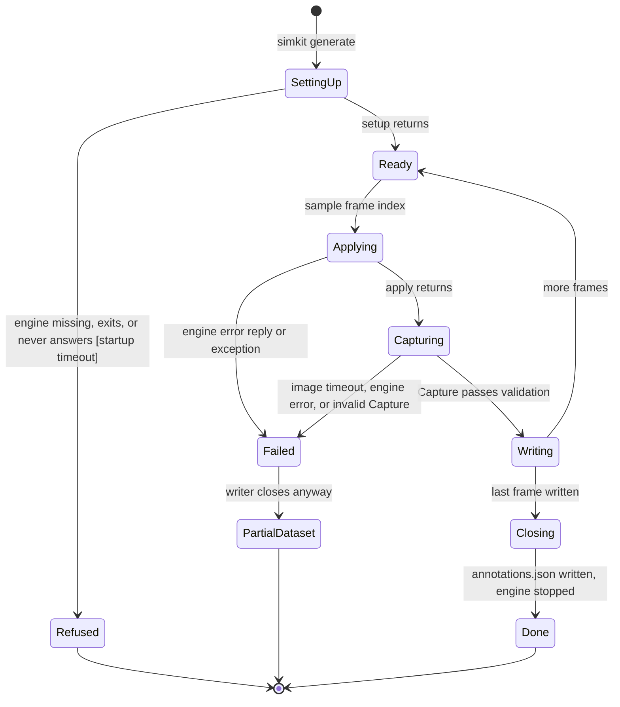

# Frame generation run

`simkit generate SCENARIO --engine E --out DIR` owns this run
([cli.py](../../source/cli.py)). It starts the engine adapter, opens the
dataset writer, and then renders frames `start` to `start + frames - 1` one
at a time. A frame is written only after the engine returned a capture that
passes validation. Any exception ends the run, but the adapter and the writer
are still closed. A failed run therefore leaves a dataset folder that looks
finished: see Partial dataset.

## SettingUp

The adapter's `setup` runs inside `with`, before the dataset writer exists.
Gazebo writes a world file and launches `gz sim`. Unity and Unreal launch
their engine through `EngineConnection` and connect to a free local port.
Engine output goes to `logs/<run>/<engine>.log`, and every startup error names
that file.

## Refused

Setup raised: no `gz` on the path, no Unity player at `$SIMKIT_UNITY_PLAYER`,
no Unreal editor at `$SIMKIT_UNREAL_EDITOR`, the engine exited, or it never
answered within the startup timeout. No dataset folder is written. See the
gaps: the engine process can be left running.

## Applying

`scenario.sample(index)` builds the FrameSpec and `adapter.apply` sends it.
The engine replaces the previous frame's objects and lights, then moves the
camera. Gazebo also steps the paused world twice here.

## Capturing

`adapter.capture` returns a `Capture`, which checks shapes and dtypes on
construction ([base.py](../../source/adapters/base.py)). Gazebo waits up to
30 s for all three sensor images stamped at the new sim time. Remote engines
raise when the server replies with an error.

## Writing

`DatasetWriter.write` saves RGB, depth and the instance mask, adds COCO boxes
for labeled objects visible in the mask, and appends the FrameSpec with K to
`frames.jsonl`.

## Failed

Any exception in apply, capture or write ends the loop and propagates.

## PartialDataset

The `with` statement still calls the writer's `close`, which writes
`annotations.json` for the frames written so far
([dataset.py](../../source/dataset.py)). Nothing in the folder records that
the run failed. Only the exit code and the traceback do.

## Done

All frames were written. `annotations.json` is complete and the adapter
stopped its engine.

## Gaps

- A failed run looks complete. `DatasetWriter.__exit__` calls `close`
  whatever the exception, so `annotations.json` and `manifest.json` exist and
  nothing marks the failure. Settled by deciding whether a failed run should
  write a marker or delete the folder.
- A setup failure can leave the engine running. `EngineConnection.__init__`
  ([remote.py](../../source/adapters/remote.py)) launches the engine before
  connecting, and `GazeboAdapter.setup` launches `gz sim` before waiting for
  it ([gazebo.py](../../source/adapters/gazebo.py)). If the wait raises,
  `__enter__` never returns, `close` is not called, and the process is not
  stopped. Not reproduced; inferred from reading.
- The success message prints the requested frame count, not a count of
  written frames. That is only wrong if the loop could finish early, which
  it currently cannot.
